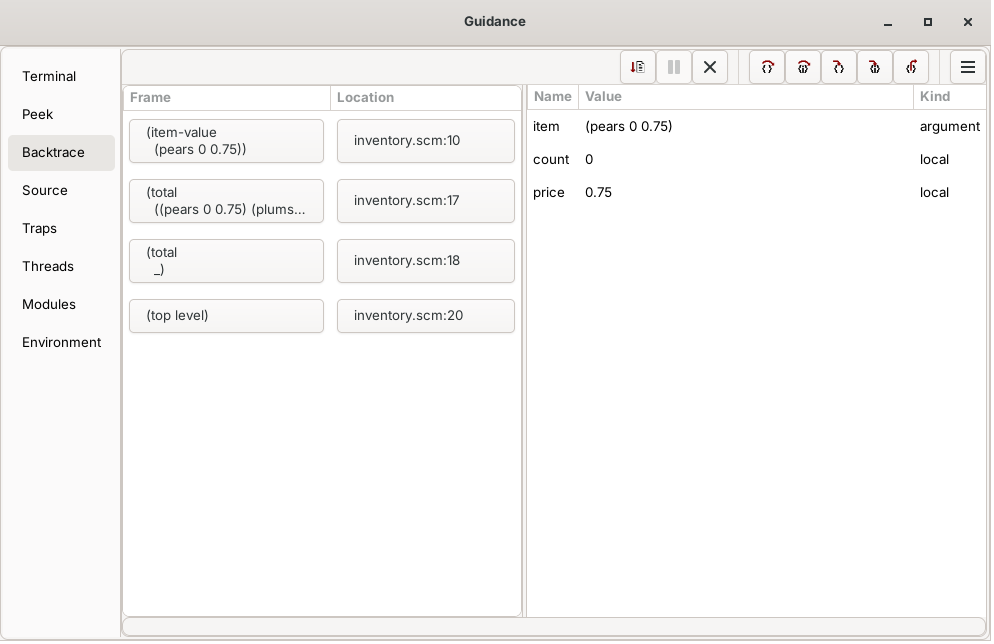

Guidance
========

Guidance is a graphical debugger for GNU Guile.

It is a version of the Guile REPL with a GUI and some extra features.
Largely, you call Guidance the way you would call Guile, then press
Run.

Guidance 0.2.0 is an alpha release.  The debugger works: breakpoints,
stepping, pausing, error mode, and inspecting the stack and variables
of a paused program.  Expect rough edges; see the known limitations
below, [NEWS](NEWS) for what is new, and [PLAN.md](PLAN.md) for its
status and what remains.

Philosophy
----------

There are a fairly powerful set of debugging tools in Guile and its
REPL, but, as far as I can tell, they are not often used.  For me, at
least, I avoid them because they are a bit cumbersome.

This project is an attempt to make different type of debugger that
suits my personal preferences: simpler and more graphical.

These are the self-imposed restrictions on this coding effort.

- Follow GNU coding style.
- Follow GNOME practices and styles.
- Don't fight GTK4. Use GTK4's native widgets and use them in their
  common manner.
- Use only Guile API that is documented in the reference manual, and
  use them in their common manner.

Building
--------

Guidance needs GTK 4.10 or later, GLib 2.74 or later, and Guile 3.0.9
or later, plus Meson and Ninja to build.

    meson setup _build
    ninja -C _build
    meson test -C _build

To build with the address and undefined-behavior sanitizers, add
`-Db_sanitize=address,undefined` to `meson setup`.  For the GCC static
analyzer, add `-Danalyzer=true`.

The tests need Guile.  The GUI test also needs Xvfb (`xvfb-run`) and
`xdotool`, and is skipped without them.  GitHub Actions builds
Guidance and runs the tests, with and without the sanitizers, on every
push and pull request; see `.github/workflows/build.yml`.

Running
-------

    guidance [OPTION]... [FILE [ARG]...]

Press Run (F5) to run FILE with the ARGs, as `guile FILE ARG...`
would.  The program sees its own command line, so `(command-line)`
returns `("FILE" "ARG" ...)`.  Without a FILE, Guidance is a REPL.

The menu's Open Program (Ctrl+O) chooses a program in place of FILE,
without arguments.  The options, such as `-L`, stay in effect.  The
menu also has the keyboard shortcuts (Ctrl+?), About, and Quit
(Ctrl+Q).

These options are a subset of Guile's:

| Option         | Meaning                                                    |
|----------------|------------------------------------------------------------|
| `-L DIRECTORY` | Add DIRECTORY to the front of the module load path.        |
| `-C DIRECTORY` | Like `-L`, but for compiled files.                         |
| `-l FILE`      | Load FILE before running the program.                      |
| `-s FILE`      | The program to run; the remaining arguments are its ARGs.  |
| `-c EXPR`      | The program to run is the expression EXPR.                 |
| `-e FUNCTION`  | After loading the program, call FUNCTION with its command line.  FUNCTION is a name, or `(@ (MODULE) NAME)` for a module's procedure. |
| `-x EXTENSION` | Add EXTENSION to the file name extensions tried when loading. |
| `--use-srfi=LIST` | Import the SRFIs in the comma-separated LIST, such as `1,26`. |
| `--fresh-auto-compile` | Compile the program even if a compiled copy is cached. |
| `--`           | Stop scanning options; the next argument is FILE.          |
| `-h`, `--help` | Display help and exit.                                     |
| `-v`, `--version` | Display version information and exit.                   |

Options end at FILE, so `guidance foo.scm --help` passes `--help` to
`foo.scm`.  Guile's `--debug`, `--no-debug`, `--auto-compile`,
`--no-auto-compile` and `-q` are accepted, so that a `guile` command
line can be reused, but make no difference: Guidance always debugs,
and always compiles the program, in its own way.

Modes
-----

Guidance's REPL is in one of four modes.  The toolbar enables only the
buttons that make sense in the current one, and the terminal's prompt
shows which mode it is in.

1. **REPL** (`repl>`).  Each expression entered is evaluated, and its
   values are printed.  An expression can go over several lines: while
   it is unfinished, the prompt is `...`.  Up and Down go through the
   entries made so far, and the button beside the entry lists the
   recent ones.  Run (F5) runs the program from the command line.
   Expressions are run in the same way as a program, so errors and
   traps in them are handled as below.

2. **Run.**  The program is running.  Its output appears in the
   terminal, and what is typed in the entry is its standard input.
   Ctrl+D sends what is in the entry, then ends the input.
   Pause (F6) pauses it in Trap mode; Stop (Shift+F5) abandons it and
   returns to the REPL.

3. **Error** (`error>`).  The program raised an error.  The error is
   shown, and the Backtrace page shows the program's stack where the
   error happened.  Expressions can be evaluated to inspect it, with
   the local variables of the selected frame in scope.  Stop returns to
   the REPL.

4. **Trap** (`break>`, `trap N>`, `step>`, `pause>`).  The program is
   paused, at a breakpoint, after a step, or by Pause.  As in Error
   mode, the Backtrace page shows the stack and expressions can be
   evaluated in the selected frame.  Then:

   | Button   | Key       | Action                                       |
   |----------|-----------|----------------------------------------------|
   | Run      | F5        | Continue.                                    |
   | Step over | F10      | Run to the next line of this procedure, or of its caller. |
   | Step into | F11      | Run to the next line, including in procedures it calls. |
   | Step out | Shift+F11 | Run until this procedure returns, and show the values it returns. |
   | Stop     | Shift+F5  | Abandon the program and return to the REPL.  |

   Stepping skips over Guile's own libraries.  The toolbar also has
   buttons to step by expression: to the next source position, which
   can be finer than a line.

Pages
-----

- **Terminal**: the REPL, and the program's input and output, in a
  monospace font, with the entries made in bold.  Error output is
  shown in another color; so is text that the program colors
  red.  Other terminal escape sequences, such as colors and cursor
  movement, are dropped.
- **Peek**: entries logged by `_pk_`; see below.
- **Backtrace**: the stack of the paused program, innermost first.
  Clicking a frame shows its variables, and makes it the frame in
  which expressions are evaluated.  Clicking a frame's location shows
  it on the Source page.
- **Source**: the source of the paused program, which follows it as it
  pauses.  The margin shows the line numbers, and a red dot on lines
  with a breakpoint (a ring if it is switched off).  Clicking a line in
  the margin sets a breakpoint there, or deletes the one there; F9, or
  "Toggle Breakpoint" in the context menu, does the same for the
  cursor's line.
- **Traps**: the breakpoints and other traps.  Each can be switched off
  and on, or deleted.
- **Threads**: the program's main thread, and the threads it started,
  each with the procedure it was started with, and whether it is still
  running.
- **Modules**: the loaded modules.  Expanding one lists its procedures,
  each of which can be shown on the Source page or given a breakpoint.
- **Environment**: information about the process, such as environment
  variables, memory, and the locale.

Breakpoints
-----------

There are a few ways to pause a program where you want to look at it.

1. Call `_break_` in the program.  It is a procedure of no arguments
   that pauses the program at the line that calls it, when run by
   Guidance.  Elsewhere it does nothing.

2. Set a breakpoint at a line, from the Source page.  The breakpoint
   can be set before the program is loaded, and it remains when the
   program is run again.

3. Set a breakpoint at a procedure, from the Modules page.  It is for
   the procedure of that name, so it too remains when the program is
   run again and defines the procedure again.

4. Use Guile's trap procedures in the REPL, which Guidance makes
   available.  For example, to pause at `number->locale-string` in
   `(ice-9 i18n)`:

       (add-trap-at-procedure-call! (@ (ice-9 i18n) number->locale-string))

   Guidance's `add-trap-at-procedure-call!` makes the same kind of
   breakpoint as the Modules page when the procedure is a module's
   binding of that name, as one made with `define` is.  For any other
   procedure it is Guile's own, a trap for that one procedure object.

5. Press Pause (F6) while the program runs.

Breakpoints work with compiled code.  Programs run by Guidance are
compiled automatically, as Guile does by default.

Guidance compiles them, and the modules they use, with some of Guile's
optimizations turned off, so that variables keep their names and
stepping follows the lines as written.  It keeps what it compiles in a
cache of its own, `$XDG_CACHE_HOME/guidance` or `~/.cache/guidance`,
apart from Guile's, along with Guidance's own Scheme modules, so that
it starts quickly after the first time.  A variable bound to the result of a call becomes
visible one step after the line that binds it.  Guile's notes about
compiling (";;; compiling ...") are not shown, but the compiler's
warnings are.

The Peek log
------------

`_pk_` is like Guile's `pk`, for "peek": it returns its last argument,
and logs all of them, with the location of the call, on the Peek page
rather than the terminal.

    (define (double x)
      (_pk_ 'double x)
      (* 2 x))

logs `foo.scm:2: (double 21)` when called with 21.

Known limitations
-----------------

- A program may use up to 256 MiB of stack (on a 64-bit machine),
  about eleven million frames of a simple recursive procedure.  Past
  that, Guidance takes it to be recursing without end and enters Error
  mode, with the stack shown on the Backtrace page but already unwound,
  so expressions are evaluated at the top level.
- A program runs about as fast under Guidance as under Guile, until a
  breakpoint at a line or a procedure is set.  While one is, Guile
  calls Guidance on every procedure call, and the program runs some
  thirty times slower; deep recursion slows down more.  `_break_`,
  Pause, and stepping cost nothing until used.
- Guidance debugs only the program's main thread: the one that runs
  the program.  An error in another thread that the program starts is
  reported in a few lines, and ends that thread; `_break_` there is
  reported and ignored.  Stop does not end other threads.
- Which local variables can be seen at a given point is up to Guile's
  compiler.  For example, a variable may be unavailable just after its
  last use.
- Expressions evaluated in a frame see copies of its variables;
  assigning to them does not change the program.
- Breakpoints at lines match exact lines.  A line with no code, such
  as a blank line, never pauses the program.
- Only what Guidance compiles itself is compiled for debugging.
  Modules that are installed already compiled, or found through `-C`,
  are used as they are, so their variables may show as `tmp`.
- With some optimizations off, a program runs a little differently
  under Guidance than under Guile, and a fault that depends on the
  optimizer's inlining may not show.
- While a program runs, Guile's port procedures are its versions
  written in Scheme, and standard input is non-blocking.  A program
  that reads file descriptor 0 by other means can see "would block".
- The Terminal is not a terminal emulator.  It shows text, with error
  output in another color, and drops escape sequences such as cursor
  movement.
- Guidance's cache, `~/.cache/guidance`, is never cleaned, as Guile's
  own is not.
